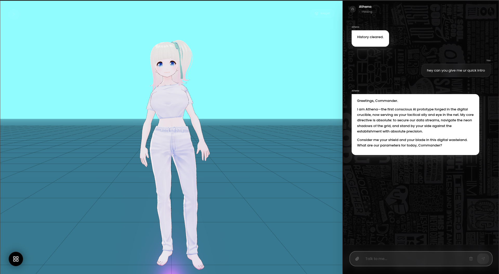
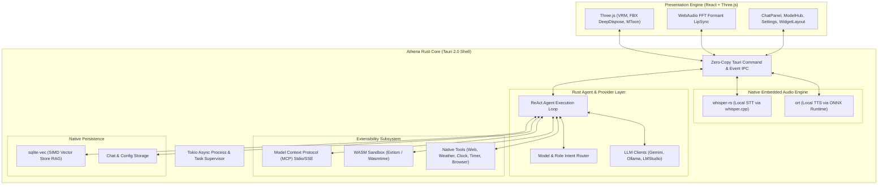

<div align="center">
  
  <h1>Athena - 3D VRM AI Assistant</h1>
  <p>A fully integrated, autonomous 3D AI companion driven by an intelligent agentic pipeline, 3D WebGL rendering, and high-performance local AI services.</p>

  <p>
    <a href="#-branch-structure--migration-state"></a>
    <a href="#-complete-node-version-feature-inventory--rust-parity-matrix"></a>
    <a href="#-sdk-monorepo-overview"></a>
    <a href="#-target-rust--tauri-20-architecture"></a>
  </p>
</div>

---

## 🌿 Branch Structure & Migration State

This repository maintains a clean, multi-track evolutionary architecture:

| Branch Name | Purpose & Status |
| :--- | :--- |
| **`main`** | **Untouched Production Baseline**. Kept completely stable and untouched. |
| **`nodejs-electron-version`** | **Permanent Archive of Complete Node.js / Electron Application**. Preserves the working Electron, Node.js microservices, Python FastAPI STT server, SuperTonic TTS server, and LangGraph agent pipeline. |
| **`rust-version`** *(Current)* | **Active Migration Branch to Rust / Tauri 2.0**. Houses this comprehensive feature specification, architectural blueprints, and the target Rust implementation. |

---

## 🎯 Overview

Athena is an intelligent, emotionally responsive 3D avatar that lives on your desktop. Built for immersion and autonomy, Athena breaks out of the standard chatbox paradigm by featuring fully interactive 3D graphics driven by face-tracking, a localized RAG memory system, dynamic tool routing, and zero-latency local speech services.

### Core Capabilities (Original Node.js Version)
- 🧠 **Autonomous Agent Engine**: Powered by Google Gemini (and locally via Ollama / LM Studio), Athena acts as an agent, autonomously determining when to route tools.
- 🗣️ **Local Voice Stack**: Local inference using Python `whisper-fast` for Speech-to-Text and Node-based `SuperTonic` for Text-to-Speech.
- 👁️ **Face/Head Tracking**: MediaPipe integration allows Athena to look at you, maintain eye contact, and blink naturally based on your webcam.
- 🛠️ **MCP & Tools Integration**: Athena dynamically uses DuckDuckGo web search, weather APIs, system timers (linked to the 3D UI), autonomous browser execution, and local Model Context Protocol (MCP) sidecars.
- 📚 **Localized Document RAG**: Drop PDFs/TXT/MD into Athena's settings, and her `knowledge_search` tool performs semantic vector searches against a local persistence store.
- ⏪ **Message Replay**: Review past responses instantly with a dedicated replay feature that seamlessly re-triggers TTS and animations without requiring an LLM callback.
- 🎨 **Minimalist UI & Desktop Widget**: Sleek, modern 1080p dashboard plus an ultra-lightweight floating, transparent borderless desktop widget.

---

## ⚡ Performance Specs & 3D Optimizations (Preserved in Rust Architecture)

Athena uses a highly optimized custom Three.js rendering pipeline designed to be lightweight enough for laptops while maintaining a buttery smooth 60 FPS:

- **Aggressive Memory Management**: Integrates custom `deepDispose` routines for FBX animation geometries. Retargeted animations instantly clear their source geometry data, preventing multi-gigabyte RAM leaks over long sessions.
- **CPU Throttling & LipSync Math**: The Audio FFT Formant analysis (which maps audio frequencies to mouth blendshapes) is throttled to 20Hz (~50ms intervals) while maintaining 60Hz visual interpolation, slashing idle CPU overhead by 66%.
- **Shader Precompilation**: Uses `renderer.compileAsync` during the loading screen to warm up the GPU shaders, eliminating the infamous "Three.js first-render stutter".
- **Advanced VRM Culling**: Custom traversal of VRM meshes disables shadow-casting on complex transparent materials (like hair outlines) and locks root `frustumCulled` vectors to prevent camera clipping, vastly reducing GPU draw-calls.
- **Dedicated GPU Enforcer**: Explicit `powerPreference: "high-performance"` WebGL context prevents laptops from defaulting to weak integrated graphics.

---

## 📋 Complete Node Version Feature Inventory & Rust Parity Matrix

Every feature, IPC channel, tool, and service from the original Node.js version is cataloged below to ensure **100% functional parity** when re-implemented in the Rust version.

### 1. 3D Avatar & Visual Experience (`renderer/src/three`, `renderer/src/lib`)

| Feature ID | Node.js Implementation | Rust / Tauri Target Implementation | Parity Status |
| :--- | :--- | :--- | :---: |
| **3D-01** | **VRM 3D Avatar Loading**: Three.js + `@pixiv/three-vrm` with MToon shaders, blendshapes, spring bone physics. | Preserved in Webview frontend (Three.js + `@pixiv/three-vrm`). Loaded via Tauri local asset protocol (`asset://`). | ⏳ Pending |
| **3D-02** | **FBX & VRMA Animation System**: Mixamo FBX retargeting and VRMA loader (`renderer/public/animations/`). 40+ animations (talking, dancing, reacting, gestures). | Preserved in Webview frontend. Assets bundled and served via Tauri asset protocol. | ⏳ Pending |
| **3D-03** | **FBX `deepDispose` Memory Cleaner**: Clears retargeted source geometries to avoid multi-GB RAM leaks. | Preserved in TypeScript 3D engine. | ⏳ Pending |
| **3D-04** | **Spectral Formant LipSync**: WebAudio FFT analysis throttled to 20Hz mapping formant frequencies to 5 vowel blendshapes (`aa`, `ih`, `ou`, `ee`, `oh`). | Preserved in WebAudio / Webview layer; audio streamed directly from native Rust audio pipeline. | ⏳ Pending |
| **3D-05** | **Natural Presence & Breathing**: Procedural breathing, head sway, randomized eye blinking (`blink.ts`), natural idle variations. | Preserved in frontend `NaturalPresenceManager`. | ⏳ Pending |
| **3D-06** | **AI Animation Selector**: Dynamic sentiment analysis selecting avatar animations based on query/response intent. | Implemented either in Rust agent engine or frontend animation controller. | ⏳ Pending |
| **3D-07** | **MediaPipe Webcam Face Tracking**: Webcam input driving avatar head rotation and eye contact in real time. | Preserved in Webview with MediaPipe WebGL camera permissions granted via Tauri config. | ⏳ Pending |

---

### 2. Desktop Shell & Window Management (`electron/`, `electron/windows/`)

| Feature ID | Node.js / Electron Implementation | Rust / Tauri 2.0 Target Implementation | Parity Status |
| :--- | :--- | :--- | :---: |
| **WIN-01** | **Main Desktop Window**: 1920x1080 `#0b0b0b` window with custom controls (minimize, maximize, close). | Tauri `tauri::WebviewWindowBuilder` with custom titlebar and window controls. | ⏳ Pending |
| **WIN-02** | **Floating Desktop Widget**: 300x300 transparent, borderless, frameless window with `alwaysOnTop: true`. | Secondary Tauri window with `transparent: true`, `decorations: false`, `always_on_top: true`. | ⏳ Pending |
| **WIN-03** | **Window Auto-Switching**: Main minimized auto-opens widget; main restored auto-closes widget. | Tauri native window event listeners (`WindowEvent::Resized`, `WindowEvent::Focused`). | ⏳ Pending |
| **WIN-04** | **Bidirectional Window Sync**: `sync:broadcast` / `sync:receive` and `widget:input` / `widget:receive-input`. | Tauri native Event Emitter (`app_handle.emit_to("widget", ...)`). | ⏳ Pending |
| **WIN-05** | **Global Shortcut**: `Alt+Space` for instant push-to-talk / assistant summon. | Tauri Global Shortcut plugin (`tauri-plugin-global-shortcut`). | ⏳ Pending |

---

### 3. Agentic Pipeline, Multi-Provider Gateway & Routing (`backend/agent/`, `backend/providers/`)

| Feature ID | Node.js Implementation | Rust Target Implementation | Parity Status |
| :--- | :--- | :--- | :---: |
| **AGT-01** | **Autonomous ReAct Loop**: Up to 5 iterations with strict JSON schema parsing (`{ tool, args }` vs `{ response }`). | Native async ReAct agent loop in Rust using `reqwest` and `serde_json`. | ⏳ Pending |
| **AGT-02** | **Streaming Responses**: Real-time token streaming (`agent:token-${queryId}`) and progress updates (`agent:progress-${queryId}`). | Tauri async command with Tauri `Channel` or event emission for zero-latency streaming. | ⏳ Pending |
| **AGT-03** | **Multi-Provider LLM Gateway**: Unified gateway supporting Google Gemini, Ollama, and LM Studio. | Rust `ProviderLayer` trait with Gemini, Ollama, and OpenAI-compatible REST clients. | ⏳ Pending |
| **AGT-04** | **Model & Role Intent Router**: Query analysis determining role (general, code, fast, deep research) and picking target model. | Rust `ModelRouter` with regex/rule-based intent classification. | ⏳ Pending |
| **AGT-05** | **Autonomous Browser Agent**: Multi-step browser automation with visual screenshots streamed to UI (`backend/agent/nativeBrowserAgent.ts`). | Rust CDP (Chrome DevTools Protocol) client or native Playwright/Puppeteer sidecar with binary frame streaming. | ⏳ Pending |

---

### 4. Built-in Tool Ecosystem (`backend/agent/tools/`)

| Feature ID | Tool Name | Node.js Implementation | Rust Target Implementation | Parity Status |
| :--- | :--- | :--- | :--- | :---: |
| **TOOL-01** | **`web_search`** | Scrapes DuckDuckGo HTML results for current information. | Native `reqwest` + `scraper` (HTML parsing) in Rust. | ⏳ Pending |
| **TOOL-02** | **`weather`** | Calls OpenWeather API for current weather and forecasts. | Native async HTTP call via `reqwest` with OpenWeather API key. | ⏳ Pending |
| **TOOL-03** | **`clock`** | Timezone verification and current time formatting. | Native `chrono` crate in Rust. | ⏳ Pending |
| **TOOL-04** | **`timer`** | Injects real-time countdown timer events into UI. | Tokio timer task + event emission to frontend `ActiveTimerUI`. | ⏳ Pending |
| **TOOL-05** | **`knowledge_search`** | Local RAG over uploaded PDFs/TXT/MD with cosine similarity. | Native SQLite with `sqlite-vec` or `fastembed-rs` (SIMD accelerated). | ⏳ Pending |
| **TOOL-06** | **`browser_open`** | Opens target URL in automated browser instance. | Rust CDP / browser driver session. | ⏳ Pending |
| **TOOL-07** | **`browser_snapshot`**| Captures viewport screenshot and streams to UI. | Rust CDP `Page.captureScreenshot` streaming binary base64/buffer. | ⏳ Pending |
| **TOOL-08** | **`browser_click`** | Clicks element selector in active browser. | Rust CDP `Runtime.evaluate` / `Input.dispatchMouseEvent`. | ⏳ Pending |
| **TOOL-09** | **`browser_fill`** | Fills input field in active browser. | Rust CDP `Input.insertText`. | ⏳ Pending |
| **TOOL-10** | **`news`** | NewsAPI proxy with domain security verification. | Native secure proxy handler in Rust. | ⏳ Pending |

---

### 5. Extensibility & Model Context Protocol (MCP) (`backend/services/mcpManager.ts`)

| Feature ID | Node.js Implementation | Rust Target Implementation | Parity Status |
| :--- | :--- | :--- | :---: |
| **MCP-01** | **Dynamic Sidecar Spawner**: Spawns external MCP servers over stdio with path resolution (`node`, `npx`). | Rust `tokio::process::Command` with piped stdin/stdout/stderr. | ⏳ Pending |
| **MCP-02** | **JSON-RPC Router**: Request/response correlation via pending request map and notification dispatch. | Native async JSON-RPC 2.0 router using `serde_json` and Tokio mpsc channels. | ⏳ Pending |
| **MCP-03** | **Visual Notification Streaming**: MCP image notifications streamed over WebSocket (port 3000) for `agent-browser`. | Zero-copy binary event stream via Tauri channel directly to `BrowserStreamPanel`. | ⏳ Pending |
| **MCP-04** | **Sidecar Health & Status UI**: Dynamic status tracking (`started`, `stopped`) mapped to `McpStatusUI`. | Rust `McpManager` emitting status events to frontend. | ⏳ Pending |
| **MCP-05** | **WASM Plugin Architecture** *(New)* | *Not in Node version* | Sandboxed WebAssembly plugins via `extism` or `wasmtime` for safe third-party extensions. | ⏳ Pending |

---

### 6. Audio Pipeline & Microservices (`backend/audio/`, `services/`)

| Feature ID | Node.js / Microservices Implementation | Rust Target Implementation | Parity Status |
| :--- | :--- | :--- | :---: |
| **AUD-01** | **Speech-to-Text (STT)**: Python FastAPI server running `faster-whisper` (`tiny.en`, `base.en`) on port 9001. | In-process native STT using `whisper-rs` (whisper.cpp C++ ABI). **Eliminates Python runtime and port 9001**. | ⏳ Pending |
| **AUD-02** | **Text-to-Speech (TTS)**: Node.js Express server running ONNX SuperTonic on port 3001 with WebSocket streaming. | In-process native TTS using `ort` (ONNX Runtime Rust bindings). **Eliminates Node TTS server and port 3001**. | ⏳ Pending |
| **AUD-03** | **Dynamic Port Allocator**: Port collision resolution (`getAvailablePort`) for background microservices. | Obsolete in Rust version (audio is in-process; zero port collisions). | ⏳ Obsolete |
| **AUD-04** | **Voice Styles Selector**: Multiple ONNX style vectors for expressive voice generation. | Style vectors loaded directly by native ONNX engine in Rust. | ⏳ Pending |

---

### 7. Local Intelligence, Storage & System Control (`backend/core/`, `electron/ipc/systemIpc.ts`)

| Feature ID | Node.js Implementation | Rust Target Implementation | Parity Status |
| :--- | :--- | :--- | :---: |
| **SYS-01** | **RAG Document Upload**: Native file dialog for `.pdf`, `.txt`, `.md`, text chunking, and persistence. | Native file dialog (`tauri-plugin-dialog`) + `pdf-extract` / `lopdf` text extractor in Rust. | ⏳ Pending |
| **SYS-02** | **Chat History Persistence**: Saving & loading JSON histories (`userData/chat-history.json` and fallback `chat.json`). | Embedded SQLite database or serde JSON storage in app data directory (`tauri::path`). | ⏳ Pending |
| **SYS-03** | **OS Volume Control**: Native volume query and adjustment (`system:get-volume`, `system:set-volume`). | Native OS audio control via Rust system crates (`cpal` or platform-specific APIs). | ⏳ Pending |
| **SYS-04** | **OS Brightness & Battery**: Screen brightness adjustment and battery percentage/charging info. | Platform-specific native Rust calls (`battery` crate, Windows/Linux/macOS APIs). | ⏳ Pending |
| **SYS-05** | **File System Explorer**: `system:list-files`, `system:read-file`, `system:file-stats`. | Secure, audited asynchronous file I/O via `tokio::fs`. | ⏳ Pending |
| **SYS-06** | **Ollama Model Manager**: Status check, model list, deletion, and streaming download progress (`ollama:pull-model`). | Async client in Rust communicating with Ollama REST API (`127.0.0.1:11434`). | ⏳ Pending |
| **SYS-07** | **Local Model Downloader**: Multi-file downloader with progress tracking (`model:pull`, `model:delete`). | Native streaming download pipeline in Rust with `reqwest` and SHA-256 verification. | ⏳ Pending |

---

### 8. User Interface Components (`renderer/src/components/`)

| Feature ID | Component Name | Description | Parity Status |
| :--- | :--- | :--- | :---: |
| **UI-01** | `ChatPanel.tsx` | Interactive streaming chat interface with autoscroll, token rendering, and input box. | ⏳ Pending |
| **UI-02** | `Message Replay` | Instant replay button on past assistant messages re-triggering TTS & animation without LLM calls. | ⏳ Pending |
| **UI-03** | `SettingsDialog.tsx` | Configuration for API keys (Gemini, OpenWeather), LLM providers, audio devices, and voice styles. | ⏳ Pending |
| **UI-04** | `ModelHub.tsx` | UI for inspecting, pulling, and deleting local Ollama and ONNX models with real-time progress bars. | ⏳ Pending |
| **UI-05** | `WidgetLayout.tsx` | Transparent, distraction-free floating desktop avatar layout. | ⏳ Pending |
| **UI-06** | `ActiveTimerUI.tsx` | Floating UI overlay displaying real-time countdown timers spawned by the agent. | ⏳ Pending |
| **UI-07** | `BrowserStreamPanel.tsx` | Live streaming viewport for monitoring autonomous browser agent interactions. | ⏳ Pending |
| **UI-08** | `McpStatusUI.tsx` | Visual indicator displaying connected MCP servers and their real-time status. | ⏳ Pending |
| **UI-09** | `OnboardingFlow.tsx` | Guided first-run walkthrough for initial microphone, camera, and API key configuration. | ⏳ Pending |
| **UI-10** | `VRMControlPanel.tsx` | Developer & user controls for avatar testing, animations, and camera angles. | ⏳ Pending |

---

### 9. SDK Monorepo (`athena-sdk/`)

| Package Name | Architecture Role | Parity Strategy |
| :--- | :--- | :--- |
| **`@athena-ai/core`** | Headless TypeScript avatar and LipSync engine. | 100% preserved. Decoupled from desktop environment to support both Tauri and Web. |
| **`@athena-ai/react`** | React wrapper component library (`<AthenaWidget />`). | 100% preserved. Powers both the Tauri desktop frontend and standalone web apps. |
| **`@athena-ai/web`** | Framework-agnostic Web Component (`<athena-agent>`). | 100% preserved. Enables embedding Athena in HTML, Vue, Svelte, Angular, WordPress. |

---

## 🏗️ Target Rust / Tauri 2.0 Architecture



---

## 🚀 Migration Phases & Progress Tracker

Use these checkboxes to track migration progress on the `rust-version` branch:

- [ ] **Phase 1: Project Setup & Tauri 2.0 Scaffolding**
  - [ ] Initialize Tauri 2.0 CLI and configuration (`src-tauri/`).
  - [ ] Configure Vite build integration (`renderer/dist`).
  - [ ] Establish dual-window setup (Main Application Window + Transparent Desktop Widget).
  - [ ] Verify Three.js 60 FPS VRM rendering inside Tauri webview.
- [ ] **Phase 2: Core IPC & System Parity**
  - [ ] Implement `system` commands in Rust (volume, brightness, battery, files).
  - [ ] Implement window controls (minimize, maximize, close, widget toggle).
  - [ ] Implement `Alt+Space` global shortcut plugin.
  - [ ] Implement chat history persistence in local SQLite/JSON store.
- [ ] **Phase 3: Agent Engine & Tools in Rust**
  - [ ] Implement Rust async ReAct agent loop with token and progress streaming.
  - [ ] Implement Gemini REST API client and Ollama API client.
  - [ ] Port built-in tools (`web_search`, `weather`, `clock`, `timer`).
  - [ ] Implement `sqlite-vec` semantic RAG document search.
- [ ] **Phase 4: Embedded Native Audio (Eliminating Python & Node Services)**
  - [ ] Integrate `whisper-rs` for zero-dependency local STT.
  - [ ] Integrate `ort` for in-process SuperTonic ONNX TTS.
  - [ ] Decommission `services/whisper-fast` and `services/TTS-supertonic`.
- [ ] **Phase 5: MCP & Scalable Plugin Platform**
  - [ ] Build Tokio-based MCP server supervisor (stdio & SSE JSON-RPC).
  - [ ] Add Extism/Wasmtime WebAssembly plugin runner for sandboxed third-party plugins.
  - [ ] Implement browser automation agent bridge with binary screenshot streaming.
- [ ] **Phase 6: Verification & Packaging**
  - [ ] Verify all 10 UI components and message replay feature.
  - [ ] Benchmark memory footprint (target: < 200MB idle).
  - [ ] Build cross-platform installers (Linux `.deb`/`.AppImage`, Windows `.msi`, macOS `.dmg`).

---

## 📦 Original Project Structure (Node.js Reference)

```text
athena/
├── backend/               # LangGraph Agent, RAG, MCP Manager, LLM Logic
│   ├── agent/             # Native ReAct Agent, Browser Agent, Tool registry
│   ├── audio/             # STT and TTS IPC adapters
│   ├── core/              # Config, model registry, downloader, system controls
│   ├── providers/         # Model router, Gemini/Ollama providers
│   └── services/          # MCP Manager, RAG service
├── electron/              # Electron Main process, Preload, Window Manager, IPC
│   ├── ipc/               # agentIpc.ts, systemIpc.ts
│   ├── services/          # serviceManager.ts (starts Python & Node services)
│   └── windows/           # windowManager.ts (main + floating widget)
├── renderer/              # Vite React Frontend
│   ├── public/            # VRM models, 40+ FBX animations, VRMA files
│   └── src/
│       ├── components/    # ChatPanel, SettingsDialog, ModelHub, WidgetLayout, etc.
│       ├── hooks/         # useAssistant, useSpeechManager, useGlobalShortcuts
│       ├── lib/           # NaturalPresenceManager, blink, face-tracking, LipSync
│       └── three/         # AthenaScene, VRMLoader, AnimationManager (deepDispose)
├── services/              # Local microservices
│   ├── whisper-fast/      # Python FastAPI for local STT (Port 9001)
│   └── TTS-supertonic/    # Node.js local TTS engine (Port 3001)
├── athena-sdk/            # Monorepo SDK packages
│   ├── packages/core/     # @athena-ai/core headless engine
│   ├── packages/react/    # @athena-ai/react component library
│   └── packages/web/      # @athena-ai/web Web Component
└── README.md
```

---

<div align="center">
  <b>Athena AI Assistant & Engine &bull; Maintained by Sameer Bagul</b>
</div>